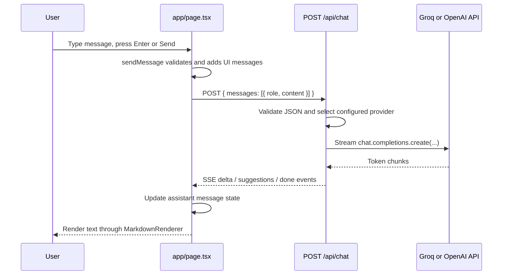

# Project Learning Guide: AI Chatbot

## 1. Project overview

This is a small, full-stack AI chat application built with the Next.js App Router. A browser user writes a message, the React page sends the conversation to the same Next.js application at `POST /api/chat`, and that server route calls either Groq (when `GROQ_API_KEY` is configured) or OpenAI. The reply is streamed back to the browser as Server-Sent Events (SSE), so text appears progressively.

The project is **one deployable Next.js application**, not a separate React frontend and Express backend. The frontend and backend route handler live in the same repository and are deployed together.

Important scope boundaries discovered during the audit:

- There is no database, ORM, SQL, , MongoDB, or other persistence layer.
- There is no sign-in, user account, session, authorization, or access control code.
- Chats live only in React memory. Refreshing the page or choosing **New Chat** removes them.
- API keys are server-only environment variables. Their values are not documented here.

## 2. Technology stack

| Technology | Where it is used | Why it is here |
| --- | --- | --- |
| Next.js 16.4.3 | Whole project | Web framework, routing, server route handler, build tooling. |
| React 19.3.0 | `app/page.tsx`, `app/components/MarkdownRenderer.tsx` | Interactive user interface and local state. |
| TypeScript | `.ts` and `.tsx` files | Type checks message shapes and component props. |
| Tailwind CSS 4 | `app/globals.css`, JSX class names | Utility classes for styling the chat UI. |
| OpenAI JavaScript SDK 7 | `app/api/chat/route.ts` | Calls OpenAI-compatible chat-completions APIs; it is also configured to call Groq. |
| Web Streams + SSE | chat route and page | Streams AI output from server to browser. |
| ESLint | `eslint.config.mjs` | Static code-quality checks. |

## 3. Folder and file map

```text
.
├── app/                         # Next.js App Router source
│   ├── api/chat/route.ts         # POST /api/chat server endpoint
│   ├── components/
│   │   └── MarkdownRenderer.tsx  # Safe, small Markdown-like renderer
│   ├── favicon.ico               # Browser tab icon
│   ├── globals.css               # Global CSS and Tailwind import
│   ├── layout.tsx                # Root HTML document wrapper and metadata
│   └── page.tsx                  # / route: interactive chat screen
├── public/                       # Static assets served directly by Next.js
├── .env.local                    # Local secret/config values; ignored by Git
├── .gitignore                    # Files Git must not commit
├── eslint.config.mjs             # ESLint configuration
├── next.config.ts                # Next.js configuration
├── package.json                  # Scripts and dependency list
├── tsconfig.json                 # TypeScript compiler settings
└── README.md                     # Default Next.js setup instructions
```

The `node_modules/` and `.next/` folders are generated dependencies/build output, not application source. Do not edit them manually.

## 4. Entry points and important files

### `package.json`

**Why it exists:** It is the project manifest: the command menu and dependency list.

**What it does:**

- `npm run dev` starts Next.js development mode.
- `npm run build` creates a production build.
- `npm run start` runs that production build.
- `npm run lint` invokes ESLint.

The runtime dependencies are Next.js, React, React DOM, and the OpenAI SDK. Tailwind, TypeScript, ESLint, and type packages are development dependencies.

**Analogy:** Think of it as the restaurant's inventory list and operating instructions.

**Learn:** Understand scripts before running a project, then identify runtime versus development dependencies.

### `app/layout.tsx`

**Why it exists:** A root layout is required by the Next.js App Router and wraps every page.

**What it does:** `RootLayout` receives `children` (the current page) and places it inside the document's `<html>` and `<body>`. It imports global styles, loads the Geist and Geist Mono fonts, and exports browser metadata (title and description).

**Data in/out:** It receives React children and returns the shared document shell. `metadata` is read by Next.js to create head tags.

**Connections:** Next.js renders it around `app/page.tsx`. The CSS variables it defines are referenced by `app/globals.css`.

**Analogy:** The layout is the building that every room in your app sits inside.

**Learn:** App Router layouts are server components by default and are the right place for shared document-level setup.

### `app/page.tsx`

**Why it exists:** A `page.tsx` at the app root creates the `/` page.

**What it does:** `ChatPage` is a client component (`"use client"`) because it uses React state, browser APIs, DOM refs, and event handlers. It renders the entire chat interface: header, starter prompts, message feed, suggestion buttons, errors, and input form.

**Important state and functions:**

| Item | Purpose |
| --- | --- |
| `messages` | The in-memory conversation displayed in the UI. |
| `input` | Text currently in the textarea. |
| `isLoading` | Prevents another send while a reply is active. |
| `errorMessage` | Text shown in the error banner. |
| `sendMessage` | Adds a user message and temporary assistant message, calls `/api/chat`, then consumes its stream. |
| `updateAssistant` | Updates only the temporary assistant message as stream events arrive. |
| `handleNewChat` | Clears the in-memory chat and input. |
| `handleCopy` | Copies an assistant response through the browser clipboard API. |
| `handleKeyDown` | Sends on Enter; Shift+Enter makes a newline. |
| `messagesEndRef` | Scroll anchor for the most recent message. |

**Data in/out:** It sends `{ messages: [{ role, content }] }` to `/api/chat`. It receives SSE objects such as `{ type: "delta", text }`, `{ type: "suggestions", suggestions }`, and `{ type: "done" }`, then renders their data.

**Connections:** Imports `MarkdownRenderer`; calls `app/api/chat/route.ts` through the browser's `fetch` API; is wrapped by `app/layout.tsx`.

**Analogy:** This is the front desk: it records what the visitor says, asks the back office for help, and displays each part of the reply as it arrives.

**Learn:** Follow one event handler (`sendMessage`) from user action to request, streamed response, and state update.

### `app/api/chat/route.ts`

**Why it exists:** In the App Router, `route.ts` defines an HTTP endpoint. This file creates `POST /api/chat`.

**What it does:**

1. `POST` reads server-only environment variables.
2. It selects Groq when a valid `GROQ_API_KEY` exists; otherwise it uses OpenAI when an `OPENAI_API_KEY` exists.
3. It parses and validates the JSON request's `messages` array.
4. It creates an `OpenAI` SDK client; Groq works because it offers an OpenAI-compatible base URL.
5. It prepends a system prompt that requests Markdown and a machine-readable suggestions suffix.
6. It starts a streamed chat-completions request.
7. It converts model chunks into SSE JSON events for the browser.

**Important functions and values:**

| Item | Purpose |
| --- | --- |
| `ChatMessage` | Type describing a chat item accepted by the provider. |
| `sse` | Converts an object to the `data: ...\n\n` SSE wire format. |
| `parseSuggestions` | Reads up to three string suggestions from the model's requested suffix. |
| `SUGGESTION_PREFIX` | Marker used to keep hidden suggestion metadata out of visible reply text. |
| `POST` | The actual server route handler. |
| `ReadableStream` | Sends reply chunks without waiting for the whole model response. |

**Data in/out:** Receives JSON from `page.tsx`; returns JSON errors or an `text/event-stream` response. It sends the full chat history and system prompt to the selected AI provider.

**Connections:** Called by `fetch("/api/chat")` in `app/page.tsx`. Uses secrets from `.env.local`, which are intentionally not exposed to the browser.

**Analogy:** It is a bilingual receptionist: it checks the request, selects the AI vendor, and relays the answer piece by piece.

**Learn:** A Next.js route handler is backend code even though it shares the `app` folder with UI code. Never import a server secret into a client component.

### `app/components/MarkdownRenderer.tsx`

**Why it exists:** AI replies are requested in Markdown, so this component presents common formatting more readably than plain text.

**What it does:** It deliberately implements a small subset of Markdown: headings, horizontal rules, unordered and numbered list items, simple tables, fenced code blocks, inline code, bold, and italic. `CodeBlock` includes a clipboard-copy button.

**Data in/out:** `MarkdownRenderer` receives `content: string` and returns React elements. `CodeBlock` receives a code string and language label.

**Connections:** Imported only by `app/page.tsx` for assistant messages. It does not use raw HTML injection, which helps avoid an HTML/XSS rendering risk.

**Analogy:** It is a typesetter that turns a plain manuscript into headings, lists, tables, and code cards.

**Learn:** The component parses untrusted model text into React elements rather than setting `innerHTML`; that is an important security distinction.

### `app/globals.css`

**Why it exists:** Defines global CSS for the whole app.

**What it does:** Imports Tailwind CSS, declares background/foreground and font theme variables, responds to the user's dark-mode preference, and sets base `body` colours/font.

**Connections:** Imported by `app/layout.tsx`; Tailwind utility classes appear throughout the JSX.

**Analogy:** This is the global visual style guide used by every room in the building.

**Learn:** Global CSS is for site-wide defaults; component-specific styling is mostly expressed with Tailwind utility classes here.

### `next.config.ts`

**Why it exists:** Configures framework-level behavior.

**What it does:** Enables Next.js 16 Cache Components and Partial Prefetching, and configures Turbopack to process Tailwind CSS. The current one-page app contains no links, so partial prefetching has no practical effect yet.

**Learn:** Configuration affects build/runtime behavior globally; check the installed Next.js documentation when changing it because this project uses Next.js 16.

### `tsconfig.json` and `eslint.config.mjs`

**Why they exist:** They set coding correctness rules.

`tsconfig.json` enables strict type checking, uses the bundler module resolver, produces no JavaScript output itself, and maps `@/*` to the project root. `eslint.config.mjs` combines Next.js Core Web Vitals and TypeScript lint rules while ignoring generated output.

**Analogy:** TypeScript is a spell checker for program structure; ESLint is a code-style and likely-bug inspector.

### `.env.local` and `.gitignore`

**Why they exist:** `.env.local` holds local configuration such as the Groq key/model. `.gitignore` ignores every `.env*` file, so secret values are not committed.

**Important:** Never paste secret values into source code, documentation, screenshots, or a client-side `NEXT_PUBLIC_*` variable.

### `public/`, `app/favicon.ico`, `README.md`, and generated files

- `public/*.svg` contains starter static assets that are not referenced by the current chat UI.
- `app/favicon.ico` supplies the browser icon.
- `README.md` is still the default Create Next App guide and does not describe this application's actual chat setup.
- `next-env.d.ts`, `tsconfig.tsbuildinfo`, `.next/`, and `node_modules/` are generated files/folders. Do not edit them.

## 5. Complete application flow



Detailed request trace:

1. The `<form>` in `app/page.tsx` calls `sendMessage()` on submit; `handleKeyDown` does the same for Enter.
2. `sendMessage` trims the text, prevents concurrent requests, creates a `userMessage`, and adds an empty, streaming assistant message.
3. It maps the conversation to only `{ role, content }` and sends it with `fetch("/api/chat", { method: "POST" })`.
4. `POST` in `app/api/chat/route.ts` validates the body and constructs an SDK client using a server environment variable.
5. The route sends the system prompt plus conversation to the configured model.
6. During streaming, the route wraps reply text in SSE `delta` events. It holds back its suggestions suffix, parses it, and then sends a `suggestions` event followed by `done`.
7. The browser reads the response body with `getReader()`, splits SSE events, parses JSON, and appends each `delta` to the temporary assistant message.
8. `MarkdownRenderer` turns the final/partial assistant string into React UI. Nothing is inserted into a database.

## 6. Authentication, security, and data architecture

**Authentication and authorization:** None. Anyone who can reach `/api/chat` can use the server's configured AI provider key. That may be acceptable for local learning, but it is not sufficient for a public paid deployment.

**Secrets:** The environment file is ignored by Git, and the route handler keeps provider keys on the server. This is a good foundation. The browser receives model output and error messages, never the configured key directly.

**Data storage:** None. There are no tables, collections, migrations, database queries, cookies, or local storage calls. Conversation data exists in page state and in the request sent to the AI provider; it disappears from the UI on refresh.

**External data boundary:** Every submitted conversation message is sent to Groq or OpenAI, depending on configuration. Do not send sensitive personal, medical, or private data unless your provider setup and product privacy policy explicitly allow it.

## 7. Code review findings

### Confirmed issues / risks

1. **Public API-cost exposure:** `POST /api/chat` has no authentication, rate limit, request-size cap, message-count cap, or per-message length cap. A public deployment could be abused to spend your provider credits or exhaust capacity. Fix this before public deployment with authentication and server-side rate limiting/validation.
2. **Untrusted `system` messages are accepted:** The route accepts `system` in client-supplied message roles. Although the current UI never sends that role, a direct HTTP caller can. Limit external input to `user` and `assistant`; keep the server's system prompt under server control.
3. **Provider error details are exposed:** For `OpenAI.APIError`, the route returns the provider's message to the browser. Some operational detail can leak. Log detailed errors server-side and return a friendly generic message in production.
4. **No cancellation on disconnect/new request:** The model stream continues until it completes even if the browser leaves or no longer needs it. Supporting an `AbortSignal`/request cancellation would reduce wasted AI spend.
5. **Generated output is stale:** Existing `.next` output includes an older version of the chat page. Generated folders should not be treated as source; run a clean development/build cycle before relying on generated output.

### Optional improvements

1. Update `README.md` with actual setup instructions, including variable names only and how to choose Groq versus OpenAI.
2. Display the actual selected provider/model rather than hard-coding Groq/GPT-OSS text in the UI.
3. Replace the hand-written Markdown subset with a maintained renderer if rich Markdown is a product requirement; retain strict HTML sanitization.
4. Add automated tests for request validation, SSE parsing, streaming failure, and the chat workflow.
5. Persist chats only after deciding the product requirements for accounts, retention, privacy, deletion, and access control.

## 8. Recommended learning roadmap

1. **Application request journey:** Trace `sendMessage` to `POST` and back through SSE.
2. **React client components:** Learn state, refs, effects, controlled form inputs, and immutable updates in `app/page.tsx`.
3. **Next.js routing:** Understand why `page.tsx` becomes `/`, `layout.tsx` wraps it, and `route.ts` becomes `/api/chat`.
4. **HTTP and streaming:** Inspect the request payload, HTTP status handling, and `text/event-stream` framing.
5. **Server secrets and validation:** Learn why the route reads `process.env` and the browser must not.
6. **AI integration quality:** Study system prompts, model selection, token/cost limits, error handling, and structured output alternatives.
7. **Production safety:** Add authentication, rate limiting, validation limits, observability, and tests before adding persistence or deployment.

## Lesson 1: How my application works from beginning to end

Start with **`app/page.tsx`**, especially `sendMessage` (around lines 96–201). It is the best first file because it connects the visible interface to the backend route.

When a user presses Send, `sendMessage` performs three jobs:

1. It turns the input into a `userMessage` object and immediately puts it in React state. This makes the UI feel responsive.
2. It sends the accumulated conversation to `/api/chat` with `fetch`.
3. It reads the streaming response and repeatedly updates the placeholder assistant message, which makes the answer appear word by word.

The key idea is that **React state is the UI's current memory**. Calling `setMessages` does not alter a database; it asks React to render the screen again using the new array.

### Small exercise

In `sendMessage`, why does the code create and display an empty assistant message *before* the API response starts arriving, instead of waiting until a complete reply is available?

Reply with your answer, and the next lesson will check it before moving on.
